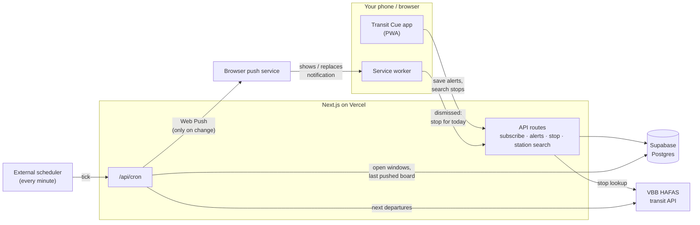

# Transit Cue

Transit Cue is a small web app that tells you when to leave for your commute in Berlin and Brandenburg.

Pick a departure stop, a destination and a time window of up to 15 minutes. When the window opens, your phone or browser shows the next three departures, like the display at the stop:

> **Eberswalder Straße → Nordbahnhof**
> M10 · 08:15 · on time
> M10 · 08:32 · on time
> M10 · 08:47 · +3 min
> Live until 08:20

The notification stays live for the whole window. Whenever a tram leaves or a delay changes, it updates in place. When the window closes, it changes to say it's no longer live, so you never act on stale times. Leave a few minutes later than usual, and the board still shows what you can actually catch.

## Features

- **Live departures** from the VBB (Berlin/Brandenburg) transit network, including delays.
- **A live notification** for a 5, 10 or 15 minute window. It updates only when the departures change, so it doesn't buzz every minute.
- **Stop for today.** Swipe the notification away, or tap *Stop for today* where your platform supports it, and it won't come back until the next day.
- **Up to 5 alerts**, each with its own route, window and repeat days.
- **Pause alerts** temporarily without deleting them.
- **No account needed.** Your alerts are tied to your browser, and nothing asks for your name or email.
- **Installable.** Add it to your home screen like a native app. On iPhone this step is required, because iOS only delivers web notifications to installed apps.

## How it works



1. When you turn on notifications, your browser registers for Web Push. The app saves your alerts against a random ID stored in your browser.
2. Once a minute, an external scheduler calls the app's cron endpoint.
3. For every alert whose window is open, the server looks up the next departures from VBB. Each route is looked up once per minute, however many alerts share it. If the departures differ from what was last pushed, it sends a push that replaces the notification on your device.
4. A minute after the window closes, the server sends one last push that marks the notification as no longer live.
5. If you dismiss the notification, the service worker tells the server to stop updates for that window today.

## Contributing

**Stack:** Next.js 16 (App Router) · React 19 · TypeScript · Tailwind CSS v4 · Supabase (Postgres) · `web-push` (VAPID) · `vbb-hafas` · `zod` · `pino` · pnpm 11. The app is hosted on Vercel, and database migrations run through GitHub Actions.

**Prerequisites:** Node.js 20+, pnpm 11 (`corepack enable`), and Docker for the local Supabase stack.

```bash
pnpm install
pnpm setup                     # generate a VAPID key pair
cp .env.example .env.local     # fill in VAPID keys, CRON_SECRET, SUPABASE_URL/_SERVICE_ROLE_KEY
pnpm exec supabase start       # local Postgres + Studio (Docker)
pnpm exec supabase db reset    # apply migrations + seed
pnpm dev                       # https://localhost:3000 (HTTPS, required for push)
pnpm dev:cron                  # optional, in a 2nd terminal: fires /api/cron every minute
```

The local Supabase credentials, the migration workflow and CI deploys are described in [`supabase/README.md`](supabase/README.md).

| Script | Does |
| --- | --- |
| `pnpm dev` | dev server over HTTPS |
| `pnpm dev:cron` | simulate the once-a-minute cron trigger locally (`CRON_URL`/`PORT` override the target) |
| `pnpm build` / `pnpm start` | production build / serve it |
| `pnpm lint` | ESLint |
| `pnpm setup` | generate VAPID keys |

**Deploying your own instance:** import the repo into Vercel and set the same env vars there. Add `SUPABASE_ACCESS_TOKEN`, `SUPABASE_PROJECT_ID` and `SUPABASE_DB_PASSWORD` as GitHub Action secrets so migrations apply on merge to `main`. Then point a scheduler such as [cron-job.org](https://cron-job.org) at `https://<your-domain>/api/cron` every minute, with the header `Authorization: Bearer <CRON_SECRET>`. Vercel's Hobby cron runs at most once a day, which is why the scheduler lives outside Vercel.
